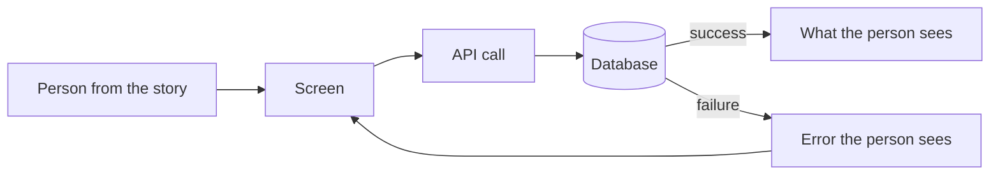
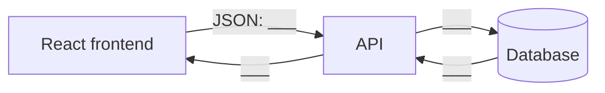

# T7B Design — Card [#]: [Card name]

**Group members and roles:**
- Diagrammer: ___
- Contract Writer: ___
- Story Checker: ___
- Presenter: ___

## User story
> As a ___, I want ___, so that ___.

## Story breakdown
- **Inputs:** ___
- **Process:** ___
- **Outputs (success):** ___
- **Outputs (failure):** ___
- **Interface:** `___ /___`

## Workflow diagram
Paste a PNG export from draw.io:

Or draw it in Mermaid (renders on GitHub):

## Component diagram

## Contract
See `schema.json`.

## Traceability
| Story phrase | Where it shows up in the design |
| --- | --- |
| "___" | ___ |
| "___" | ___ |
| "___" | ___ |

## What we changed after feedback
- ___ because ___
